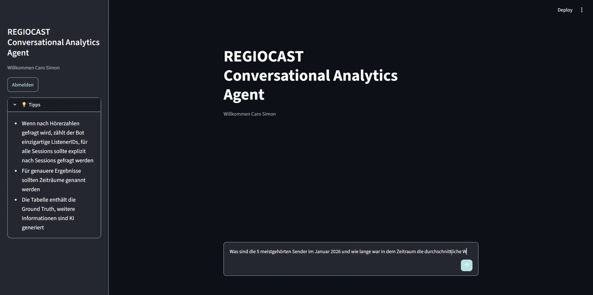
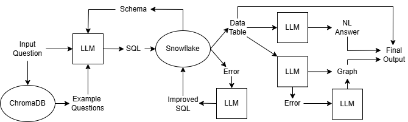

# Snowflake AI Agent
An AI agent pipeline that converts natural language questions into SQL requests and turns the fetched data back into natural language answers and generated graphs. Comes with custom streamlit interface.



This was part of a project for a real client. Two important steps (the cleaning and preprocessing of the given data, as well as the creation of the example questions) unfortunately cannot be published in order to respect the clients privacy.

## Architecture


## Implementation
First the generate_chroma.py file needs to be filled with example questions. Also the .env File needs to be created with the login data for the snowflake database and the Groq Api-Key. Additionally the secrets.toml needs to be changed to contain the needed data for the Microsoft Entra ID.

After that, the agent can be run using the following command.

```console
git clone https://github.com/CarodoesCoding/Snowflake_AI_Agent
python generate_chroma.py
streamlit run dashboard.py
```
